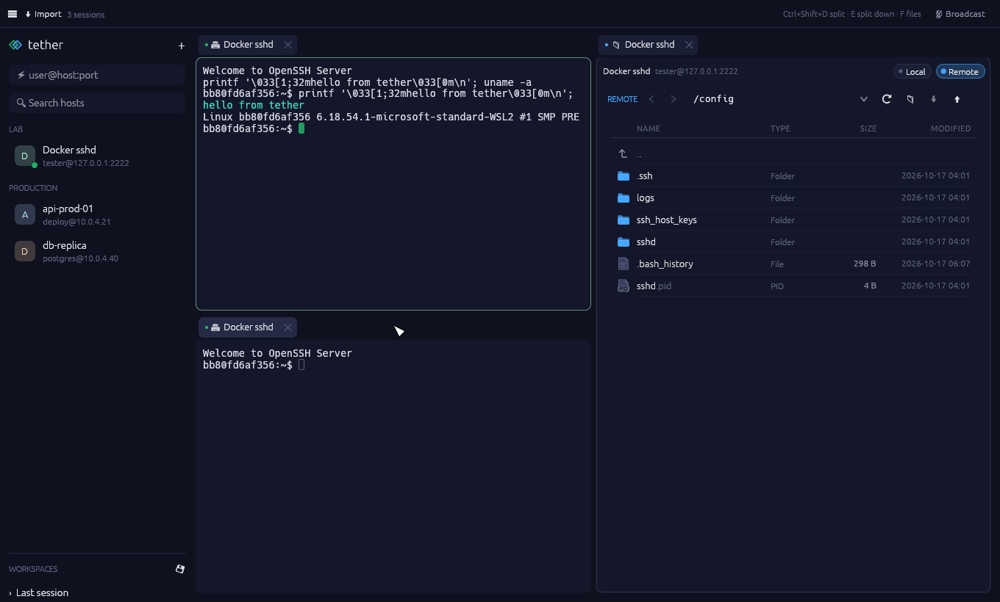

# tether

SSH terminals and fast SFTP side by side, in one native Rust window.



A personal project: the split-pane workspace of Termius plus the SFTP speed of Bitvise, with no Electron and no account. Built with [egui](https://github.com/emilk/egui) and [russh](https://github.com/Eugeny/russh).

## Features

- **Split workspace**: drag any terminal or SFTP tab into any split layout. Saved workspaces, broadcast input to several terminals.
- **Fast SFTP**: one SSH connection is shared by every tab, and transfers keep up to 4 MB of requests in flight. That's about 2–3× faster than a plain client at 20 ms latency.
- **Hosts**: nested folders, drag and drop, archive, search and quick connect (`user@host:port`). Imports hosts from `~/.ssh/config` and Bitvise.
- **Key manager**: generate, import and export keys, add or change a passphrase, and install a key on a server in one click.
- **SFTP that remembers**: each host reopens in its last folder, and *Go to terminal folder* follows the shell next to it.
- **Secure by default**: secrets live in the OS credential store, host keys are trusted on first use, and tether refuses to connect if a host key changes.
- **Customisable**: themes, and every shortcut can be rebound (*Settings → Keyboard*).

## Install

Windows is the main target. Other platforms compile, but they are untested.

```sh
git clone https://github.com/izLoki/Tether
cd Tether
cargo build --release   # → target/release/tether.exe
```

Requires Rust 1.85+ (edition 2024).

## Develop

```sh
cargo test                               # unit + headless UI tests (screenshots in target/ui-shots/)
TETHER_E2E=1 cargo test -- --test-threads=1   # against a real server, see tests/e2e_ssh.rs
```

Config lives in `%APPDATA%\tether\tether\config\`. Set `TETHER_CONFIG_DIR` to move it.

## License

[MIT](LICENSE)
